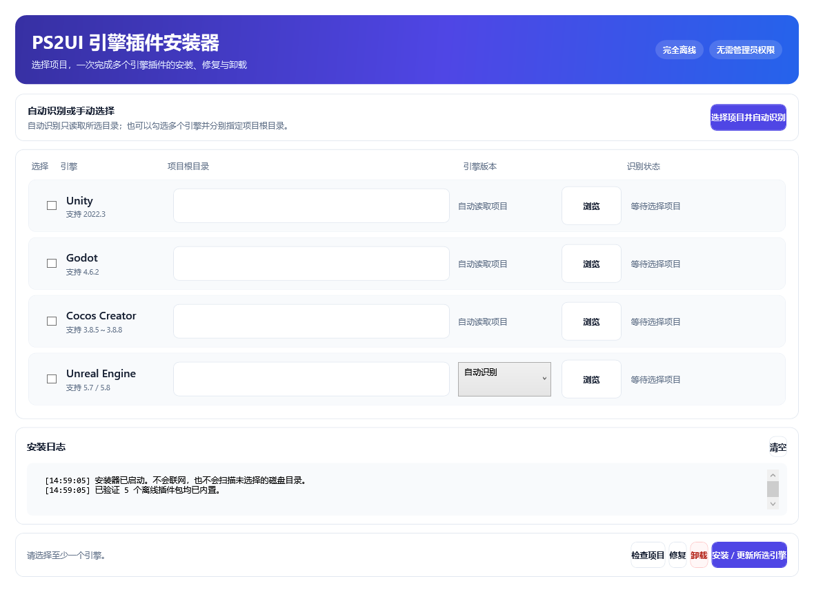
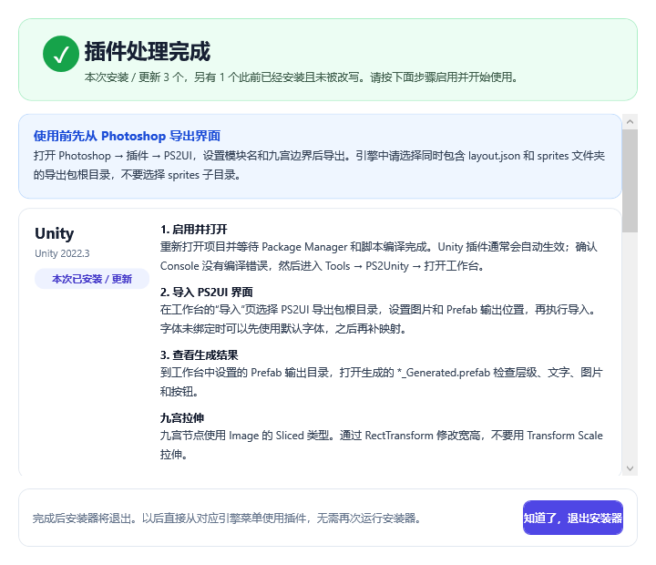
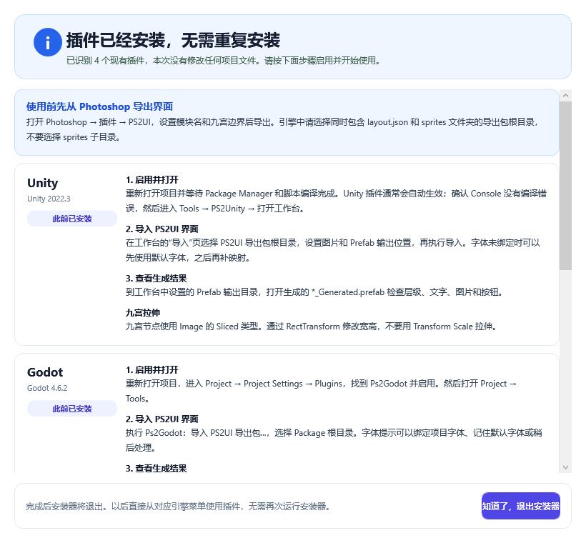

# PS2UI 引擎插件安装器

这是 PS2UI 多引擎插件的 Windows 离线安装器。双击一个 EXE，即可为项目安装 Unity、Godot、Cocos Creator 和 Unreal Engine 插件。发布仓库只包含安装成品和使用说明；安装器源码位于私有的 `PS2UI-Source` 仓库。

## 下载与版本

当前版本：`0.1.1`

- [下载 PS2UI-Engine-Installer-0.1.1.exe](https://github.com/Homer79980/PS2UI-Installer-Releases/releases/download/v0.1.1/PS2UI-Engine-Installer-0.1.1.exe)
- [SHA-256 校验文件](./PS2UI-Engine-Installer-0.1.1-SHA256.txt)

校验文件内容应为：

```text
65DC99C15F38897AD9E6F29C1FD54AAF13213CFA1FC559C50489CDAA2134D454  PS2UI-Engine-Installer-0.1.1.exe
```

PowerShell 校验命令：

```powershell
Get-FileHash .\PS2UI-Engine-Installer-0.1.1.exe -Algorithm SHA256
```

## 支持范围

| 引擎 | 安装器内置插件 | 已验证版本 |
|---|---:|---|
| Unity | Ps2Unity `2.1.1` | Unity `2022.3` |
| Godot | Ps2Godot `0.1.1` | Godot `4.6.2` |
| Cocos Creator | Ps2Cocos `0.1.1` | Creator `3.8.5` 至 `3.8.8` |
| Unreal Engine | Ps2Unreal `0.1.1` | Epic Launcher UE `5.7`、`5.8` Win64 |

安装器目前只支持 Windows 10/11 x64，使用普通用户权限运行。它不支持 macOS、Linux、Windows ARM、Unreal 源码编译版或表格之外的引擎版本。

## 安装方法

1. 关闭准备安装插件的 Unity、Godot、Cocos Creator 或 Unreal Editor。安装器不会强制结束编辑器进程。
2. 下载 EXE 和 SHA-256 文件，先完成哈希校验。
3. 双击 `PS2UI-Engine-Installer-0.1.1.exe`。如果 Windows SmartScreen 显示“未知发布者”，请先核对 SHA-256；当前测试版尚未进行 Authenticode 签名。
4. 选择“自动识别项目”，或手动勾选一个或多个引擎，并分别选择对应的项目根目录。
5. 点击“检查所选项目”，确认项目类型、引擎版本、已安装插件版本和冲突提示。
6. 点击“安装所选引擎”。多个引擎会逐个处理，一个项目失败不会回滚其他已成功项目。
7. 安装完成页会按引擎显示启用方式、导入菜单、生成目录和九宫操作提示。
8. 点击“知道了，退出安装器”，再打开对应编辑器完成启用。

项目根目录必须是包含对应工程文件的目录，不要选择插件压缩包、`sprites` 子目录或已经生成的资源目录。

安装位置：

```text
Unity   <项目>/Packages/com.psd2unity.uiimport
Godot   <项目>/addons/ps2godot
Cocos   <项目>/extensions/ps2cocos
Unreal  <项目>/Plugins/Ps2Unreal
```

## 安装后如何使用

所有引擎都使用同一套流程：先安装 Photoshop 端 PS2UI，导出 Package，再在对应引擎中导入这个 Package。Photoshop 插件不包含在本安装器内，请从 [PS2UI Releases](https://github.com/Homer79980/PS2UI/releases/latest) 单独下载 `PS2UI-Photoshop-<版本>.ccx`。

### Unity

1. 打开项目并等待 Unity 完成脚本编译。
2. 在菜单中打开 `Tools -> PSD2Unity -> 打开工作台`。
3. 选择包含 `layout.json` 和 `sprites` 的 PS2UI 导出包根目录，不要选择 `sprites` 本身。
4. 导入完成后，在项目窗口查看生成的 UI 资源和场景。
5. 九宫资源使用 Unity UI 的 `Image Type = Sliced`，修改 `RectTransform` 的宽高，不要用 Scale 拉伸。

### Godot

1. 打开 `Project -> Project Settings -> Plugins`，启用 `Ps2Godot`。
2. 重新打开项目，执行 `Project -> Tools -> Ps2Godot：导入 PS2UI 导出包...`。
3. 选择包含 `layout.json` 的导出包根目录。
4. 等待“Ps2Godot 导入完成”，到 `res://ps2godot/<模块名>/scenes` 打开场景。
5. 九宫节点是 `NinePatchRect`，修改 `Layout` 的宽高，不要修改 `Scale`。

### Cocos Creator

1. 打开项目，确认扩展管理器中的 `Ps2Cocos` 已启用；如果菜单没有出现，重启 Creator。
2. 执行 `扩展 -> Ps2Cocos -> 导入 PS2UI 导出包...`。
3. 选择包含 `layout.json` 和 `sprites` 的导出包根目录。
4. 等待导入完成，到 `assets/ps2cocos/<模块名>/prefabs` 打开生成的 Prefab。
5. 九宫 Sprite 的类型应为 `SLICED`，修改 `UITransform Width/Height`，不要用 Scale 拉伸。

### Unreal Engine

1. 在 `Edit -> Plugins` 中确认 `Ps2Unreal` 已启用；如果 UE 提示需要重启，先重启编辑器。
2. 执行 `Tools -> Ps2Unreal：导入 PS2UI 导出包...`。
3. 选择包含 `layout.json` 的导出包根目录。
4. 到 `Content/Ps2Unreal/<模块名>/Widgets` 打开生成的 Widget Blueprint。
5. 九宫 Image 的 `Brush -> Draw As` 应为 `Box`；修改外层控件宽高，不要使用 Render Transform Scale。

## 字体与资源复用

导出包已经携带当前设计使用的字体身份、字号、行距、对齐和文字框尺寸。没有字体 JSON 也不影响图片、九宫、层级和文字布局导入。项目没有匹配字体时，引擎会使用默认字体并提示待绑定；默认字体的字形宽度可能导致换行和字形外观不同。

导入时引擎会在用户明确执行导入命令后扫描项目资源：

- RGBA 像素、尺寸和九宫边界完全一致时，复用项目已有资源。
- 仅相似、缩放或镜像的资源会先询问，不会静默替换。
- 复用不会修改项目已有图片、SpriteFrame、Texture 或字体资源。

## 已安装、更新、修复与卸载

- 再次检查已安装项目时，安装器会显示“已经安装、未做修改”，不会把它报告成新的安装失败。
- “修复”只恢复安装器之前管理的插件目录。
- 安装器会把被替换的插件备份到 `%LOCALAPPDATA%\PS2UI\EngineInstaller\Backups`。
- “卸载”只处理带 `.ps2ui-install.json` 安装回执的目录，不会删除用户手动安装或自行维护的同名插件。
- Unity 的旧版 `Assets` 安装、外部 UPM/Git 引用和标准 UPM 目录会被识别；检测到外部维护版本时，安装器会阻止重复安装，不会自动移动或覆盖它。

## 安全和已知边界

- 安装器本身不联网、不上传项目路径、不全盘扫描，也不执行项目内脚本。
- 安装前会检查 ZIP 路径，拒绝路径穿越、符号链接和目录联接。
- 安装使用临时目录和原子替换；失败时恢复旧插件。
- 只写入上述插件目录，不触碰 `Assets`、`Content`、导入生成目录或业务资源。
- 编辑器运行时文件可能被锁定；请先关闭编辑器再安装、修复或更新。
- Unreal 二进制包只保证 Epic Launcher 的 UE 5.7/5.8 Win64。源码编译版、自定义 Build ID 或其它平台需要对应的源码/二进制包。
- 当前测试版未签名，SmartScreen 可能提示未知发布者。发布包的真实性以 GitHub Release、SHA-256 和后续代码签名为准。

## 截图

主界面：



安装完成页：



已安装提示：



## 问题排查

如果安装器提示项目类型不匹配，请选择真正的项目根目录：Unity 应包含 `Assets`、`Packages`、`ProjectSettings`；Godot 应包含 `project.godot`；Cocos 应包含 `assets` 和项目配置；Unreal 应包含 `.uproject`。

如果提示编辑器正在运行，请保存项目并完全关闭对应编辑器后重试。若安装完成但菜单没有出现，先在编辑器的插件管理页启用插件，再重启编辑器并等待编译完成。

如果导入失败，请确认选择的是 PS2UI 导出包根目录，而不是 `sprites` 子目录；同时确认 Photoshop 端使用的是 PS2UI，而不是旧版 PS2Unity 导出脚本。
